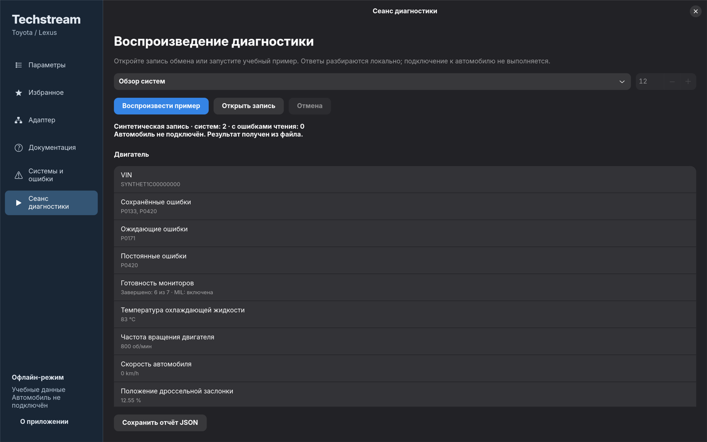
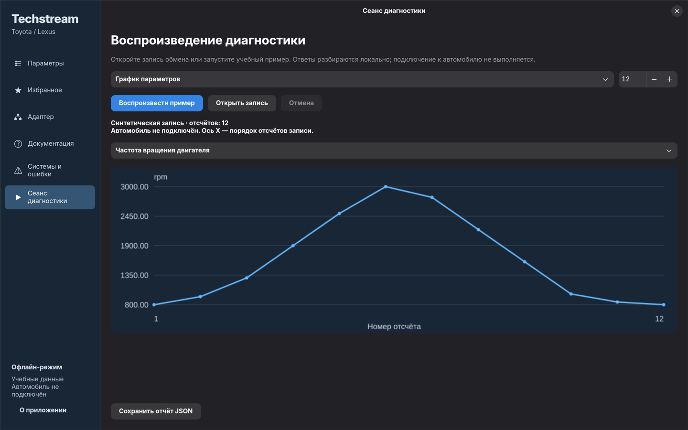

# Techstream for Linux

[](https://github.com/gon7187/techstream/actions/workflows/ci.yml)

[Русский](README.ru.md) · [Getting started](docs/getting-started.md) · [Contributing](CONTRIBUTING.md)

An independent native Linux diagnostic workbench for Toyota/Lexus research, written in Python with GTK4 and libadwaita. Select local vehicle definitions, inspect diagnostic resources and native recordings, and execute offline diagnostic workflows without Windows, Wine, an adapter, or a car.

**This is an early implementation, not a complete replacement for Toyota Techstream. All physical vehicle communication remains `PHYSICAL_UNCONFIRMED`.** The desktop interface is currently in Russian.

## Development checkpoint — 21 October 2026

The no-car port is **work in progress** and feature development is paused for handoff. The current checkpoint is on [`offline-completion-20261020`](https://github.com/gon7187/techstream/tree/offline-completion-20261020). Implemented components, independently checked cases, known failures and missing integrations are documented separately; the final software gate remains open.

- [Current status, known defects and ordered roadmap](docs/development-handoff.md)
- [Roadmap: implemented, missing and next](docs/ROADMAP.md)
- [Implementation map and module responsibilities](docs/implementation-map.md)
- [Reproducible checks and evidence boundaries](docs/verification.md)
- [Repository graph and navigation guide](graphify-out/GRAPH_REPORT.md) · [interactive map](graphify-out/graph.html)

The graph was built by Luna from authored source and documentation. It is a navigation aid, not evidence of vehicle compatibility. Manufacturer files, private research and credentials are excluded.



## Try it

The core tools use Python 3.11+ and the standard library. No manufacturer data is required:

```sh
git clone https://github.com/gon7187/techstream.git
cd techstream
python -m scripts.session_cli replay examples/diagnostic-session.json --output /tmp/session.json
python -m unittest discover -s tests -v
```

For the desktop, install the system GTK dependencies described in [Getting started](docs/getting-started.md), then run:

```sh
./techstream --demo
```

The demo generates authored synthetic resources. Its codes, names and values are examples, not diagnostic advice or observations from a vehicle. The launcher uses a separate Linux network namespace; it does not change the host firewall. Systems that disable unprivileged user namespaces need the [documented direct launch](docs/getting-started.md#network-isolation).

## What works

| Area | Available now | Boundary |
| --- | --- | --- |
| Desktop workbench | Search groups/parameters, regions, favorites, CSV export, source hashes | Local resource browsing; no live vehicle values |
| Vehicle definitions | Model/year/option selection, system associations, selected command frames, exception overlays and support bits | Explicit resource selection; real vehicle identity and support unconfirmed |
| Diagnostic resources | CT parameter groups, current/legacy DDB containers, DTC/freeze-frame definitions and native numeric conversion | Recovered per-table layouts; data supplied separately |
| Offline diagnostics | Strict replay, standard OBD support/monitors/compound values, Toyota command engines, active-test lifecycle, charts and JSON reports | Native family coverage is documented separately; synthetic traffic is not ECU compatibility |
| Native recordings | DM playback, saved signal conversion, TSE index/DataList import and editing, DRS commands, byte-preserving copying | Other recording families remain explicitly tracked |
| Transport | Mongoose framing, JLR identity/version, raw CAN, host ISO-TP, firmware ISO and K-line lifecycle | Synthetic packet/fault tests; physical behavior unconfirmed |
| Script runtime | CSDF execution and native library providers, XML actions/dialogs/COMM and utility bindings | Requires selected descriptors and injected I/O providers |
| Calibration and recorder | CUW/S-record inspection, native transfer fragments, programming simulation, native VIM storage/DRS operations | Full family-specific programming and recorder coverage still under recovery |

Toyota-specific byte codecs are separately documented in [native command recovery](docs/toyota-protocol.md); they do not infer vehicle support.

Run the [offline workflows and file tools](docs/offline-tools.md), or inspect the [feature matrix](docs/full-port.md), [architecture](docs/architecture.md), [offline session format](docs/offline-diagnostics.md) and [hardware validation plan](docs/hardware-validation.md). Adapter branding or a USB ID does not establish Toyota compatibility.

## Bring your own data

The public repository contains authored source, documentation and synthetic fixtures. It does **not** distribute Toyota/Lexus software, original manuals, installers, drivers, license keys, activation tools, or extracted manufacturer databases. Obtain any required data separately with the necessary rights; see [local resource import](docs/getting-started.md#local-resource-import).

The [MIT license](LICENSE) covers the project's authored material. It grants no rights to third-party products or data. This project is independent and is not affiliated with or endorsed by Toyota, Lexus, or adapter manufacturers. Product names belong to their respective owners.

## Development

```sh
python -m unittest discover -s tests -v
ruff check scripts tests techstream.py
ruff format --check scripts tests techstream.py
shellcheck techstream
```

CI runs the core checks without proprietary resources and exercises the demo GUI under Xvfb. Contributions should preserve strict parsing, bounded I/O, offline reproducibility and honest evidence boundaries. Read [Contributing](CONTRIBUTING.md) and [Security](SECURITY.md) before sharing logs or hardware traces.


