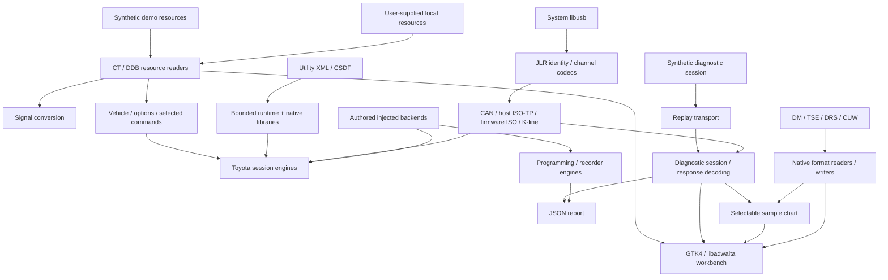

# Architecture

The project separates a native GTK workbench, resource decoders and offline transport/diagnostic code. Core modules use the Python standard library. GTK, libusb and optional OpenSSL libcrypto are system runtime dependencies for the corresponding desktop and USB paths.

The diagram shows implemented modules and data paths, not a claim that every path is wired into a complete live diagnostic engine.

## Entry points

| File/module | Responsibility |
| --- | --- |
| `techstream` | Launch Python in an isolated Linux network namespace |
| `techstream.py` | Desktop presentation, background loading, selection and export |
| `scripts.demo` | Generate authored synthetic resources for a clean checkout |
| `scripts.session_cli` | Run offline diagnostic replay and write a report |
| `scripts.workbench` | Catalog search, local favorites, CSV and passive USB inventory |
| `scripts.pid_catalog` | Parse CT parameter groups |
| `scripts.diagnostic_db` | Decode DDB containers and diagnostic definitions |
| `scripts.profiles`, `scripts.support` | Vehicle and option joins, selected communication frames, exception overlays and PID support |
| `scripts.signal_conversion` | Bounded bit extraction and numeric conversion |
| `scripts.mongoose_protocol` | Frame encoding/decoding and protocol inspection |
| `scripts.jlr`, `scripts.jlr_channels` | JLR USB lifecycle, identity and channel message structures |
| `scripts.isotp` | Host-side ISO-TP sender/receiver state machines |
| `scripts.diagnostics`, `scripts.replay` | Diagnostic response interpretation and deterministic replay |
| `scripts.script_vm` | CSDF objects/operators, bounded execution and optional SRP/SRPLST inspection |
| `scripts.toyota_session` | Selected Toyota commands, native DTC/freeze/active-test and routine behavior |
| `scripts.utility`, `scripts.utility_bindings`, `scripts.script_libraries` | XML execution and native callback contracts with explicit host services |
| `scripts.snapshot` | Native monitor buffers, signal conversion, TSE sections and recording playback |
| `scripts.calibration`, `scripts.programming` | Calibration validation, recovered native protocol fragments and distinct host simulation |
| `scripts.drive_recorder` | Native DRS commands, VIM logical packets and storage operations |
| `scripts.offline_tools` | Executable authored workflows, file inspection and source-preserving native copying |
| `scripts.offline_verify` | Reviewed software-coverage ledger and fail-closed completion checks |

## Evidence boundaries

Resource formats are recovered from local static research and checked against synthetic regression cases. Supported subsets and unresolved fields are described in [DDB](ddb-format.md), [conversion](signal-conversion.md), [Mongoose framing](mongoose-protocol.md), [JLR](jlr-native.md), [channels](jlr-channels.md) and [script runtime](script-vm.md).

Replay makes request/response behavior deterministic and testable without a device. Mock USB tests exercise failure paths and cleanup. Neither proves that a particular adapter implements those messages correctly or that an ECU accepts them. Physical validation remains `PHYSICAL_UNCONFIRMED`; see the [validation plan](hardware-validation.md).

The desktop selects vehicle definitions, browses resources, inspects native files
and executes replay or authored workflows. Reference rows remain separate from
decoded recording values; neither is presented as a live vehicle measurement.
The executable engines use injected exchange and lifecycle providers, bounded
budgets, cancellation and explicit native error states. Family-specific gaps
remain software work in the [feature matrix](full-port.md) and coverage ledger;
they are not reclassified as physical observations.

## Data and trust boundaries

Manufacturer resources are external inputs, never bundled dependencies. Parsers validate structure and bounds before exposing decoded values. Favorites and exports are local user data, separate from the source tree. Protocol code must reject truncated/mismatched responses and preserve cleanup on cancellation and errors.

The public tree contains authored code and synthetic fixtures only. Private research artifacts, extracted manuals and original distributions are excluded. CI runs from that public tree without downloading or executing manufacturer binaries.

Some format notes retain identifiers of private `analysis/evidence` archives. Those archives and original binaries are deliberately absent from the public checkout; public evidence includes binary hashes, function addresses, recovered contracts and authored regression cases.
