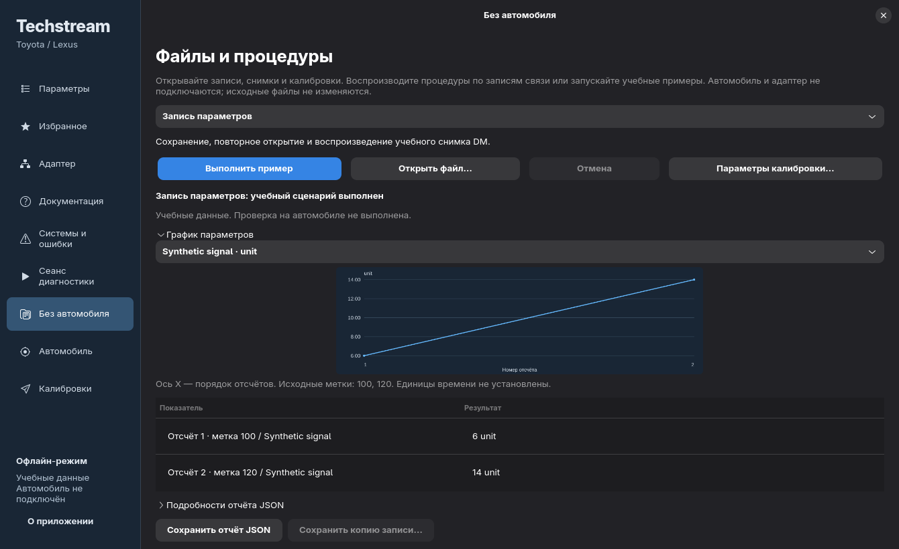

# Getting started

The console tools require Python 3.11+ and use the standard library. The desktop additionally requires Linux, PyGObject, GTK4 and **libadwaita 1.5+**. USB probing uses the system libusb-1.0 library through `ctypes`; no Python USB package is needed.

## Desktop dependencies

Arch Linux:

```sh
sudo pacman -S --needed python python-gobject gtk4 libadwaita libusb librsvg util-linux
```

Debian 13 / Ubuntu 24.04 or newer, with sufficiently recent libadwaita:

```sh
sudo apt install python3 python3-gi gir1.2-gtk-4.0 gir1.2-adw-1 libusb-1.0-0 gir1.2-gdkpixbuf-2.0 librsvg2-common util-linux
```

Use the distribution's Python so it can import the distribution's `gi` bindings. A generic virtual environment may hide these bindings. Debian 12's default libadwaita is too old for the current interface.

## Synthetic demo

From the repository root:

```sh
./techstream --demo
```

No downloaded database is necessary. The demo uses synthetic resources and normal application features: group/parameter search, favorites, CSV export and diagnostic definitions. The interface is currently Russian.

Generate a reusable synthetic resource tree without opening GTK:

```sh
python -m scripts.demo --output /tmp/techstream-demo
```

The generator's output is test/demo data, not an OEM database. For a diagnostic replay with no desktop or hardware:

```sh
python -m scripts.session_cli replay examples/diagnostic-session.json --output /tmp/session.json
```

See [offline diagnostics](offline-diagnostics.md) for the session contract and interpretation of the report. Replay does not contact USB or a car.

## Local resource import

Obtain compatible resources separately with the necessary rights. The public checkout supplies no vendor data, installers, activation tools or keys. Do not commit imported material.

Keep an extracted application tree in a private local directory. The workbench recognizes regional parameter groups in this layout:

```text
application/
  Techstream_Data_NA/PIDGroup/.../*.CT
  Techstream_Data_EU/PIDGroup/.../*.CT
  Techstream_Data_JP/PIDGroup/.../*.CT
```

Run with the desired parameter root:

```sh
./techstream --root /path/to/application/Techstream_Data_NA/PIDGroup
```

The application can discover sibling regions. You can also choose a source directory with the folder button. A custom directory of CT groups is supported; diagnostic database discovery additionally needs the compatible application layout. Missing resources and unsupported formats do not imply a vehicle fault. Read [CT/resource behavior](native-linux.md) and [DDB format](ddb-format.md) for supported structures.

The public project does not automate acquiring licensed software. Importing data does not activate a diagnostic engine or enable live values.

## Network isolation

`./techstream` uses `unshare --user --map-current-user --net` before launching Python. This creates an isolated network namespace without changing host firewall rules. Some distributions or container policies disable unprivileged user namespaces; the command then fails before the application opens.

For a deliberate direct launch with no network namespace, use the system Python:

```sh
python3 techstream.py --demo
```

The application itself is an offline workbench, but the direct command does not enforce network isolation. Prefer the launcher where supported. Do not change global system security settings merely to run the demo.

## State and checks

Favorites live in `$XDG_DATA_HOME/techstream/saved.json`, or `~/.local/share/techstream/saved.json`. Source resources are separate from this state. CSV export writes the selected results to the destination you choose.

```sh
python -m unittest discover -s tests -v
./techstream --demo --smoke-test
```

The smoke test opens the GUI, exercises workbench behavior, and exits with a failing status if an assertion fails. For a headless Linux development environment with Xvfb and a D-Bus session launcher installed:

```sh
sh scripts/desktop-smoke.sh
```

The headless runner uses X11 and temporary runtime, configuration, cache and data directories. Its private D-Bus session uses the GTK portal backend, so it cannot activate a second Hyprland portal or replace the desktop document-portal mount. Avoid running a private `dbus-run-session` against your desktop's existing `XDG_RUNTIME_DIR`.

This checks the rendered demo interface and synthetic data paths. It does not validate USB, an ECU or road use.

## Files and procedures without a car

Open **Без автомобиля** in the sidebar. Choose a procedure and click **Выполнить пример**: Toyota diagnostics, service procedures, diagnostic scripts, parameter snapshots, calibration transfer, recorder commands, adapter exchange, OBD monitors and communication logs. These examples execute the native parsers and engines with authored data and simulated I/O. They never connect to an adapter or a vehicle. **Отмена** cancels the operation; a failed or cancelled operation can be repeated.



**Открыть файл…** reads a local DM, DRS, TSE, native communication log, CUW, SREC, utility XML, CSDF `.bin` or native exchange JSON file, up to 32 MiB for native files (recording JSON and procedure inputs retain their own stricter bounds). Supported parameter snapshots show selectable charts and a table of decoded values. When a DM or TSE contains several supported captures, the capture selector reloads the chosen buffer; report-only TSE files show their records without inventing a chart. The horizontal axis is sample order; original timestamp fields stay literal because their physical time unit has not been established. Unknown native fields remain available under **Подробности отчёта JSON** and in the exported report.

**Сохранить отчёт JSON** exports the complete report, even when the visible table is limited to 1000 rows or raw preview to 100000 characters. It refuses to overwrite the inspected source. For native DM/DRS/TSE containers and communication logs, **Сохранить копию записи…** re-encodes and verifies byte-for-byte preservation, including unknown records, before saving to a different file. Opening or copying a file does not execute its commands or modify it. The desktop's table and chart are scrollable in compact windows; the menu button opens navigation.

**Параметры калибровки…** accepts explicitly selected parameter tables and optional DLL files. Native table encoding is the default; enable the plain CSV/INI option for decoded tables. The desktop reads library exports and FileVersion statically, then lets you choose an exact source key, stage and any required observed CALIDs, LocationID, diagnostic addresses or previous address pairs. **Показать план без отправки** applies the recovered table selection, address selectors and module/version checks. Missing observations or dependencies produce an error; they are not supplied automatically. No DLL runs and no data is sent. The resulting plan does not establish vehicle compatibility. All selected source files, including DLLs, are protected against replacement by the report export. The selection is bounded to 256 files, 16 MiB each and 64 MiB total. Long displayed cells are clipped; the exported JSON keeps their complete content.

The same examples are available without GTK:

```sh
python -m scripts.offline_tools example snapshot --output /tmp/snapshot-report.json
python -m scripts.offline_verify workflows
```

Read [service procedures](utility-runtime.md), [script libraries](script-libraries.md), [snapshot formats](snapshot-format.md), [calibration transfer](programming.md), [calibration tables](calibration-catalog.md), [recorder commands](drive-recorder.md), [communication logs](communication-log.md), [Toyota sessions](toyota-session.md) and [adapter channels](jlr-channels.md) for the supported operations and evidence boundaries. A successful example is not a physical vehicle test.

## Vehicle and system selection

Open **Автомобиль** and choose the resource region. Select the database's vehicle categories in order, then answer its equipment questions. The category names and available choices come from the region's native tables; regions need not expose the same categories. Changing an earlier category resets the dependent choices. **Загрузить каталог заново** restarts selection.

The resulting systems are associated with that vehicle by native database keys. **Открыть** opens the selected system's diagnostic definitions. **Действия → Показать команды** lets you choose a native function identifier and inspect its request bytes and reply mask/check without sending anything. The result is shown on **Без автомобиля** and can be exported as JSON. These views do not establish which ECUs are installed or which resource variants a physical vehicle accepts.

**Действия → Воспроизвести запись…** replays a compatible native exchange recording against the selected vehicle/system profile. Choose **Готовность по базе**, **Выбранные параметры** with explicit hexadecimal signal keys, or **Выбранная команда** with an original function identifier. You may select an ECU by its recording label. The result opens on **Без автомобиля** with cancellation and guarded JSON export. This flow uses `techstream-native-exchange-v1` recordings, distinct from the standard OBD recordings opened on **Сеанс диагностики**. Readiness and parameter reads require explicit PID-length observations inside the recording; missing observations fail before any exchange. The support flag and numeric result are displayed separately; the desktop does not infer monitor completion from either one.

Selected-command replay checks the database's reply masks and the recording's exact request order. It preserves response bytes without assigning an unproven diagnostic meaning to them. Report export protects the exchange recording and the management, language and selected ECU resource files against replacement.

See [native exchange recordings](native-replay.md) and [native readiness](readiness.md) for the recording schema, required observations and interpretation limits.

The authored demo includes two model years, an equipment question, a system association and selectable command frames. Imported regional resources provide their own vehicle choices; missing or unresolved branches show an error instead of guessing a vehicle or protocol.

## Diagnostic session views

The desktop session page offers system overview, parameter charts, calibration identifiers, OBD monitors, support maps, parameter reads and vehicle information. Each of the seven modes has an authored example and accepts compatible recordings. Choose the sample count for a polling recording. Charts use sample order, not an assumed original time scale. JSON export preserves decoded values and rejects overwriting the source recording.

For the new reading modes, an optional ECU name selects a configured ECU from the recording; an unknown name is rejected. Support maps expose the recorded OBD service and legacy sensor mask. Parameter reading accepts a hexadecimal PID list and an optional frame-zero freeze-frame mode. An empty PID list reads all advertised parameters with known decoders. Requests must match the recording's exact order; missing or leftover exchanges fail instead of synthesizing a response. Some recordings therefore require a particular mode and PID selection.

```sh
python -m scripts.session_cli poll examples/live-session.json --samples 12 --output /tmp/live-report.json
python -m scripts.session_cli calibration examples/calibration-session.json --output /tmp/calibration-report.json
python -m scripts.session_cli monitors examples/monitors-session.json
python -m scripts.session_cli support examples/support-session.json --service 1
python -m scripts.session_cli parameters examples/parameters-session.json --pids '0C,0D'
python -m scripts.session_cli vehicle_info examples/vehicle-info-session.json
```

Without `--root`, a checkout without imported data opens synthetic demo resources automatically. Demo resources and favorites are temporary. Pass `--root /path/to/application` to use an existing local source tree.

SRP inspection optionally uses system OpenSSL `libcrypto` through `ctypes`; no vendor key or library is distributed. See [script formats](script-vm.md).

**Действия → Выполнить процедуру…** opens an imported native service XML resource or CSDF script for the selected vehicle/system. Select a verified key library explicitly for encrypted XML. Optional record-data attachments require their exact native logical name in hexadecimal; the application never follows file paths embedded in a script. After inspection, select an XML function and open a `techstream-native-procedure-v1` recording. This recording supplies initial variables, language policy, communication options and chronological driver/PDU results. Missing context fails explicitly.

XML screens display the resource's text, radio choices, enabled keys and elapsed progress. Radio changes use the resource's display action before enabling a key; the application does not guess an answer. **Прервать** closes the screen and cancels the worker. The recording deadline also applies while a screen waits for input; expiration closes it and preserves a failed timeout report. CSDF execution preserves its actual library events, stack values and errors in the report. Failed, incomplete and cancelled runs retain their status. JSON export protects every selected resource, profile database, attachment and recording against replacement. All execution remains offline and physically unconfirmed.

After opening native DRS settings, **Воспроизвести работу регистратора…** opens a chronological native recorder recording. It uses the actual DRS start/stop and protocol operations, recorded interface capabilities and trigger input. The result shows packet values, a trigger marker and a selectable chart. **Сохранить снимок DM…** is enabled only for a complete capture whose recording includes explicit monitor and system metadata; both input files are protected against replacement. See [native recorder replay](recorder-replay.md) for the recording format and error/cleanup behavior.

Imported XML can also use an explicitly selected original U_*.ddb language file or translation JSON file through **Файл перевода подписей XML…**. Missing external labels remain unresolved in the report; the desktop does not guess translations.

The **Калибровки** page accepts a CUW calibration, a captured stage, selection INI tables and original module files. **Проверить выбранные файлы** checks their identities and the stage's declared node before offering its captured operation. Execution consumes the recording once; a completed captured stage does not mean that a vehicle was programmed. Export protects every selected input. Additional files are attached explicitly and are never opened through paths embedded in the capture. Give each attachment its exact logical name from the recording; the same file can be attached under several names. Editing these names requires checking the selection again before execution.

For a selected vehicle system, **Действия → Активные тесты по записи…** opens a recorded active-test lifecycle. The native initialization supplies the available tests, values, controls, buttons and input-byte counts. The application displays those controls and runs the matching recorded start, test and cleanup operations. Reload the recording before repeating a consumed or failed lifecycle. This does not actuate a vehicle.

The programming page also opens recorded TIS/Euro requests, RKS window interactions and completion notifications. Seven authored examples exercise these captured operations. Native response codes and unresolved results remain visible; neither a completed replay nor a key-shaped value confirms a service entitlement. This page makes no external service or browser calls.

Under **Калибровки → Локальный запрос и ответ RKS**, enter the eight request fields explicitly to save a new native XML request. License and seed fields are hidden in the form. Export publishes a complete file with private permissions and preserves every existing destination. **Проверить XML-файл ответа…** checks the native Signature XML shape and reports its length without displaying or exporting its value. This format check does not authenticate the key or bind it to a vehicle; no service is contacted.

Active-test fields follow the selected initialization: signed decimal values, legacy auxiliary byte, Routine input bytes and supported P5 output masks appear only where the native contract uses them. Explicit Routine bytes replace scalar assembly; byte counts and signed limits come from the selected test. Raw record words remain in report details.


For a selected vehicle system, **Действия → Процедура Toyota по записи…** opens a strict recorded Toyota workflow. The selected databases, function observations and captured operation must match. Optional PSD input is selected explicitly and inspected without running its DLL. The result retains native return codes and flags, errors and unconsumed events. A successful replay does not delete faults in a connected vehicle.

The active-test recording dialog optionally accepts both **Viewer.ddb** and a **V_*.ddb** language file. After initialization, **Описание активного теста** shows the three native help resources in their recorded order. **Дополнительные подсказки** presents available Init instruction references using the Linux host's explicit resource policy; this does not claim the original Windows dialog lifecycle. Missing resources stay unresolved. Both selected help files are protected against replacement by report export, and their source hashes and presentation policy remain in JSON.

Native TSE reports require an explicit text codec in **Кодировка текста TSE** before textual sections are decoded. Select the codec used by the saved file, then **Прочитать текст отчёта** and choose a named report section. The DTC table keeps separate Current, Pending, History and Permanent columns from the saved marker strings; an absent legacy field is shown as «Поле отсутствует». Freeze-frame state and number remain separately labeled raw values. At compact window sizes, scroll the DTC table horizontally for all status columns and scroll the page for comments, saved details and export controls. Selecting another report section keeps the full source report available for JSON export; a wrong text codec produces an error and can be corrected and reloaded without changing the file. Saved AllDTC XML follows its own declared/native Unicode encoding and displays its stored status labels.

**Действия → Прочитать RAM по записи…** accepts an explicit hexadecimal RAM address, a byte count and a direct/cache choice for the selected system. The recording must match the selected source databases and native frame. Results contain raw bytes and actual exchange statuses, including partial replies on errors. No DDR history, engineering value or automatic memory-address meaning is inferred.

Named TSE sections also show stored MIL messages/confirmation fields, Error/TMR contact and application settings, initial VIN/selection choices, operation-history calendar/content/time fields, and DDR support/value pairs. The DDR logical ID label names the ordinary schema slot; it is not an observed identifier saved in the file, and P5 producers can populate a slot from another ID. Raw selectors, support DWORDs and time fields remain numeric without inferred enums, units or timezone. Source strings, including words such as `pending`, remain literal in TSE and saved AllDTC XML. Long detail names show the final field first; the full path and value remain available in tooltips and JSON.

**Воспроизвести нативный монитор…** opens a `techstream-native-monitor-v1` recording against the current region's Toyota/M language databases. The recording binds the exact database hashes and selected module context, then supplies chronological native driver results to the recovered normal, Dual, variable, A8 or combined oscilloscope path. Completed captures offer **Сохранить снимок DM…**. Combined captures keep separate monitor and oscilloscope outputs: select each stream before saving its DM file. Source mismatches, incomplete recordings and cancellation retain their actual failure status. An unresolved native value type stays unresolved rather than becoming a numeric plot. This covers the selected implemented paths; it does not implement every native queue or Multi lifecycle.

**Нативные процедуры Toyota (TY18)** requires five explicit inputs: `IT3UtilityTY2.dll`, `UtilityEx2TY.dll`, a `techstream-native-utility-v1` raw recording, the selected `U_*.ddb` and `UtilityResID_NK.rsd`. **Воспроизвести выбранную процедуру** runs the recovered DoorClear controller against recorded driver events and resolves its screen text through those exact language resources. The initial conditions screen and its native Next button precede execution. Progress, acknowledgement and native result codes follow the controller; closing its dialog cancels the worker. These files are parsed as source data; no vendor DLL is executed. The chooser exposes the recovered DoorClear and EFI61 controllers, and every result remains physically unconfirmed.

The dedicated DDR parameter table keeps the saved display text, raw value, identifier and raw sample flags together. Raw sample flags are not an inferred validity marker. The DTC detail **Freeze frame data check** is the native equality check `freeze_frame_state_raw == 1`; its boolean and the unchanged raw state are shown separately.

For mapped DDR samples, nonzero or missing native invalidity entries display the unresolved resource key `DISPLAY_VALUE_INVALID`. The original stored display remains separately labeled in details and JSON. Native channel suppression is reported explicitly; no guessed localized invalid-value caption is used.

DTC details also retain **Маркер freeze frame** as the exact saved string, including `!`, `!!` or `!!!`. It is separate from the raw state and data check; it does not assert that a native button is enabled.

The native Toyota procedure form now offers **Очистка истории соединения (DoorClear)** and **Сброс оценки коротких поездок (EFI61)**. Both use the same five explicitly selected source inputs. EFI61 first reads recorded support, then shows the source conditions and only the supported checkbox choices. Native **Next** stays disabled until a choice is selected. The second supported choice keeps its original ID1 even when the first is unavailable. Selecting nothing cannot start the write phase; close the dialog to cancel. Selected IDs are returned to the source controller and its recorded native operations. This offline replay does not reset an ECU in a vehicle.
